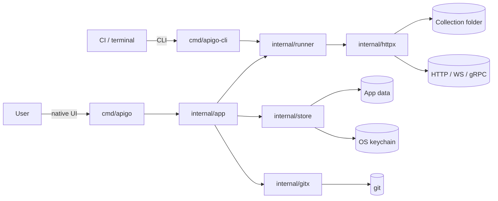
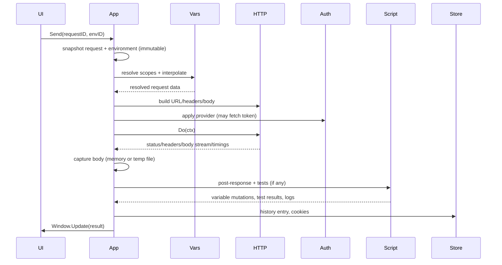
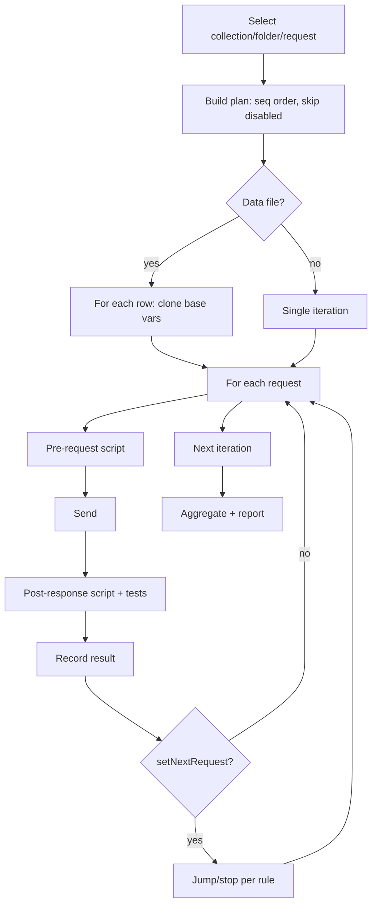

# Architecture

Status: target architecture for 1.0. The foundation implements only the package
skeleton; each milestone fills a slice. Decisions are recorded in
[decisions/](decisions/).

## 1. System context

apigo is one offline desktop application with two front ends over one engine:



There is no server, no account and no background sync. The collection folder is
portable and authoritative; app data holds only UI state, history, cookies and
secrets.

## 2. Principles

1. **Plain files, boring formats.** `.bru` in, `.bru` out. No database as the
   source of truth for collections.
2. **One engine, two front ends.** The app and the CLI call the same request,
   script and runner packages. A behavior that exists only in the UI is a bug.
3. **Pure Go.** `CGO_ENABLED=0`, cross-compiles from any host, no bundled
   Node/Chromium. Native UI via MyGo.
4. **Domain first.** Parsing, variables, HTTP and scripting are testable without
   a window or a network where possible.
5. **Explicit compatibility.** Every divergence from Bruno is documented and
   tested, never accidental.
6. **Local by default.** Network calls happen only for a user-initiated request,
   a Git operation the user asked for, or an update check the user enabled.
7. **Cancellation and bounds everywhere.** Requests, scripts, streams, disk
   writes and Git operations accept a context and have a size/time budget.

## 3. Packages

| Package                   | Responsibility                                                                         | May import                        |
| ------------------------- | -------------------------------------------------------------------------------------- | --------------------------------- |
| `internal/bru`            | `.bru` tokenizer, parser, AST, printer                                                 | stdlib only                       |
| `internal/opencollection` | OpenCollection YAML parser/printer (neutral AST)                                       | stdlib, YAML library              |
| `internal/collection`     | Typed model, discovery, format detection, ordering, environments, inheritance, watcher | `bru`, `opencollection`           |
| `internal/vars`           | Scopes, precedence, interpolation, dynamic variables                                   | `collection`                      |
| `internal/httpx`          | URL/body building, transports, cookies, response capture, timings                      | `bru`, `collection`, `vars`       |
| `internal/auth`           | Auth providers and inheritance application                                             | `httpx`, `collection`             |
| `internal/script`         | goja runtime, `bru`/`req`/`res`, module shims                                          | `collection`, `httpx` (types)     |
| `internal/assert`         | Assertion DSL parser/evaluator                                                         | `collection`                      |
| `internal/runner`         | Execution plan, iterations, flow control, results, reporters                           | engine packages                   |
| `internal/convert`        | Importers, exporters, code snippets                                                    | `collection`, `httpx`             |
| `internal/gitx`           | Git CLI wrapper, status/diff/commit model                                              | stdlib, `collection`              |
| `internal/store`          | Settings, history, cookies, keychain, recent files                                     | stdlib, bbolt, MyGo               |
| `internal/app`            | Services, commands, state transitions shared by UI                                     | all engine packages               |
| `internal/ui`             | Views, widgets, input, formatting for display                                          | `app`, `ui`, `ui/editor`          |
| `cmd/apigo`               | Window creation, menus, lifecycle                                                      | `ui`, `app`, `mygo`               |
| `cmd/apigo-cli`           | Argument parsing, text output, exit codes                                              | `runner`, `convert`, `collection` |
| `internal/version`        | CLI version injection                                                                  | stdlib                            |

Rules:

- `internal/bru` is a leaf. It does not read files; callers provide bytes.
- `internal/app` must not import `internal/ui` or MyGo. Commands are plain Go
  methods returning results/events.
- `internal/ui` contains no business rules beyond presentation state. If a
  decision needs a test without a window, it belongs in `app`.
- Interfaces are declared by the consumer, with the smallest surface.
- No package-level mutable state. Configuration is passed explicitly through a
  `Deps`/service struct.

## 4. Domain model

The model mirrors the file format, not Bruno's Redux store:

```go
type Collection struct {
    Root       string
    Name       string
    Requests   []*Request   // flattened view for search; tree owns nesting
    Folders    []*Folder
    Auth       Auth
    Headers    []KV
    Vars       []Variable
    Script     Scripts
    Tests      string
    Docs       string
    Proxy      *Proxy
    ClientCert *ClientCert
    Extra      []RawBlock  // unknown blocks, preserved verbatim
}

type Request struct {
    ID        string
    Path      string      // file path, relative to collection root
    Meta      Meta        // name, type, seq
    Method    string      // GET, POST, ... CUSTOM
    URL       string
    Params    []Param     // path/query, enabled, description
    Headers   []KV
    Body      Body        // mode + content/files/graphql vars
    Auth      Auth        // mode + config or inherit/none
    Vars      []Variable  // pre-request, post-response
    Scripts   Scripts
    Tests     string
    Assert    []Assertion
    Docs      string
    Examples  []Example
    Settings  Settings
    Extra     []RawBlock
}
```

Key model rules:

- `ID` is stable for the lifetime of a tab, not persisted. File path + collection
  root identify a request across reloads.
- Values keep their raw form. Interpolation happens at execution time, never at
  load time.
- `Enabled` is explicit on every list item; disabled entries are written with
  the `~` prefix.
- Unknown blocks/fields are retained in `Extra` and printed after known blocks.
- Environments are separate documents (`Environment`) with `SecretNames` and
  values; secret values are resolved from the keychain at execution time.

## 5. Execution flow — one request



Ordering that matters:

1. Pre-request script runs before interpolation of the final request? Bruno
   runs pre-request scripts with variables, then interpolates. The exact order
   is defined and tested in [REQUEST_ENGINE.md](REQUEST_ENGINE.md); the app
   follows that spec, not intuition.
2. Auth is applied after user headers so the provider can replace the
   `Authorization` header, unless the mode says to append.
3. Response cookies are stored before the post-response script, so scripts can
   inspect them.
4. Post-response script and tests run even on non-2xx responses (unless the
   request failed at the transport level); test failures do not discard the
   response.
5. History and cookies are written off the UI thread; failures are reported but
   do not fail the request.

## 6. Execution flow — collection run



The runner is a state machine, not a recursive walk, so `setNextRequest`, bail
and cancellation are explicit. It emits progress events to the UI and a final
`RunResult` consumed by reporters.

## 7. Concurrency and UI lifetime

- The UI renders on the main thread. All request execution, file parsing,
  Git operations and script runs happen on worker goroutines.
- Each tab owns a `context.CancelFunc`; closing a tab cancels its in-flight work.
  A result carries the tab's generation number, and stale results are dropped.
- App state is mutated only on the main thread (through `Window.Update`). Worker
  results are immutable snapshots.
- File watching delivers events on a goroutine; the app debounces, re-reads on
  the main thread and invalidates only the affected subtree.
- Never capture `*ui.Context`, elements or widget parts in a goroutine or app
  state. Capture `c.Services()` only for persistent callbacks.
- Scripts run with `goja.Interrupt` on timeout; the goroutine is joined before
  the result is published.
- Response bodies above `inlineBodyLimit` (default 10 MiB) stream to a temp
  file; the UI reads a window and never loads the whole file for display.

## 8. Storage layout

### Collection (user-owned, portable)

```text
my-collection/
├── collection.bru
├── folder.bru
├── environments/
│   ├── Local.bru
│   └── Production.bru
├── .env
├── users/
│   ├── folder.bru
│   ├── list.bru
│   └── get.bru
└── README.md
```

### App data (machine-local, not portable)

`mygo.App.Path(mygo.PathUserData)`:

```text
apigo/
├── settings.json       preferences, theme, layout
├── state.json          open tabs, last collection, pane sizes
├── history.db          bbolt: request history
├── cookies.db          bbolt: per-collection cookie jars
├── cache/              response temp files (cleared on quit/age)
├── logs/               rotating diagnostic log (no secrets)
└── recent.json         recent collections (paths only)
```

Secrets never live in these files. Small values are stored through the OS
keychain (MyGo secrets: service `<identifier>`, account
`collection:<hash>:var:<name>`). MyGo caps a secret at 2,560 bytes, so larger
blobs (for example a PKCS#12 client certificate) are encrypted with AES-GCM
using a random data key; the data key lives in the keychain and the ciphertext
in a `0600` file under app data. If the keychain is unavailable, the app prompts
and keeps the value in memory for the session only.

**Why bbolt instead of SQLite:** history and cookies are small key-value data,
bbolt is pure Go, fast, and adds no prebuilt library download. If a future
feature needs SQL (for example mock-server logs), it gets its own ADR and
storage, not a rewrite of history.

## 9. Error model

```go
type Kind string

const (
    KindConfig   Kind = "config"   // invalid collection, missing field
    KindIO       Kind = "io"       // file, keychain, database
    KindNetwork  Kind = "network"  // DNS, connect, reset
    KindTLS      Kind = "tls"      // certificate, handshake
    KindTimeout  Kind = "timeout"
    KindCanceled Kind = "canceled"
    KindAuth     Kind = "auth"
    KindScript   Kind = "script"
    KindAssert   Kind = "assert"
    KindInternal Kind = "internal"
)

type Error struct {
    Kind Kind
    Op   string
    URL  string
    Err  error
}
```

- Errors are values; wrap with `%w` and preserve `errors.Is`/`As`.
- HTTP status codes are **not** errors. A 404 is a successful request with a
  response; only transport/protocol failures produce `KindNetwork`/`KindTLS`.
- The UI shows a short message plus a details pane with the unwrapped chain.
- The CLI maps kinds to exit codes (see [RELEASE.md](RELEASE.md#exit-codes)).
- Script errors include the script kind (pre-request, post-response, test) and a
  best-effort line number.

## 10. Performance budgets

Measured on the reference machine (Apple silicon, release build) and tracked in
`internal/**/bench_test.go`:

| Metric                                | Budget    |
| ------------------------------------- | --------- |
| Cold start to interactive window      | < 150 ms  |
| Open collection (1,000 requests)      | < 300 ms  |
| Search across 10,000 requests         | < 100 ms  |
| Parser throughput                     | > 20 MB/s |
| 10 MB JSON pretty-print + render      | < 200 ms  |
| Scroll frame time with 100k-line body | < 16 ms   |
| Idle memory (one collection, 20 tabs) | < 120 MB  |
| Tab switch (cached response)          | < 50 ms   |
| Runner overhead per request           | < 5 ms    |

Rules: no full-body copy when avoidable; stream large bodies; virtualize lists;
cap script output; debounce watchers; measure before optimizing.

## 11. Cross-platform

- Paths: `filepath`, `os.UserHomeDir`, MyGo paths. Never hard-code `/` or `~`.
- Line endings: read CRLF and LF; write LF for `.bru` (Bruno-compatible), keep
  user content line endings where the format preserves them.
- Filesystem: case-insensitivity on macOS/Windows means IDs use normalized
  relative paths; rename detection handles case-only changes.
- Keychain: MyGo secrets API on all platforms; tests skip when unavailable.
- Git: shell out to `git`; detect its absence and show an actionable message.
- TLS: system roots plus custom CA; certificate stores differ per OS.
- Menus/shortcuts: `Cmd` on macOS, `Ctrl` elsewhere; use MyGo's `ui.Mods`.
- Native UI: verify with `go tool mygo vet .` and a real window on each OS.

## 12. Extensibility (post-1.0)

Internal extension points, not a public ABI:

- Auth providers: `auth.Provider` registry, keyed by `.bru` mode.
- Importers/exporters: `convert.Importer`/`Exporter` with a format ID.
- Reporters: `runner.Reporter` receiving `RunResult`.
- Script modules: a whitelist registered in `script.Modules`.
- Protocol handlers: `httpx.Protocol` for GraphQL/WS/SSE/gRPC.

A public plugin ABI is deliberately out of scope until the core is stable; Node
module compatibility would be a separate engine decision (see ADR-0003).

## 13. Related decisions

- [ADR-0001: Native UI with MyGo](decisions/ADR-0001-native-ui.md)
- [ADR-0002: Clean-room .bru compatibility](decisions/ADR-0002-bru-compatibility.md)
- [ADR-0003: goja for scripts](decisions/ADR-0003-scripting-engine.md)
- [ADR-0004: net/http transport](decisions/ADR-0004-http-transport.md)
- [ADR-0005: Git CLI integration](decisions/ADR-0005-git-cli.md)
- [ADR-0006: Separate CLI binary](decisions/ADR-0006-cli-binary.md)
- [ADR-0007: bbolt for local state](decisions/ADR-0007-local-storage.md)
- [ADR-0008: Single-window tabbed workbench](decisions/ADR-0008-tabbed-workbench.md)
