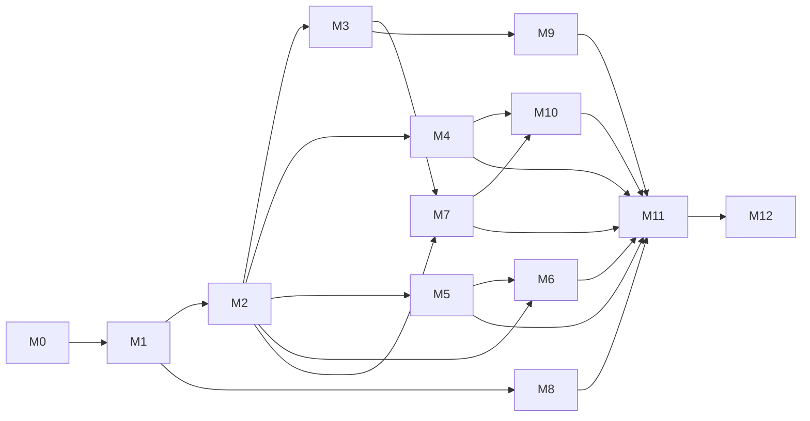

# Roadmap

Status: living document. Last structural review: 2026-10-21.

This roadmap turns "replicate Bruno" into a sequence of releases with testable
exit criteria. It is deliberately behavior-first: the `.bru` files, request
results, scripts, tests and CLI behavior are the contract, not the shape of
Bruno's React components.

## Target and non-goals

**Target.** Functional parity with Bruno 2.0.0's open-source desktop app and
CLI for the workflows in [CAPABILITY_MATRIX.md](CAPABILITY_MATRIX.md), plus
bidirectional `.bru` collection compatibility.

**Non-goals for 1.0.**

- Pixel-identical UI, React/Electron internals, or Bruno's plugin architecture.
- Bruno's paid/cloud collaboration features (workspaces, cloud sync, team
  features). apigo is offline-only.
- Running arbitrary Node.js packages in scripts. The supported module surface
  and divergences are documented in [SCRIPTING.md](SCRIPTING.md).
- A plugin marketplace. Internal extension points may exist, but no public
  plugin ABI before 1.x.

"Complete" means every P0/P1 row in the capability matrix is `done` and covered
by a test, and the conformance suite passes against Bruno fixtures. Any row that
cannot be met gets an ADR explaining the divergence and an explicit matrix
status (`divergent`), not a silent omission.

## How to read the plan

- **Milestone** = a releasable slice with a demo and an exit gate.
- **Task** = one focused PR, identified as `M<number>-<nn>` in
  [BACKLOG.md](BACKLOG.md).
- **Agent-week** = one agent working with full context for ~5 days. Estimates
  include tests and docs, not review latency. They are for sequencing, not
  promises.
- A milestone can start before the previous one is fully polished only when its
  dependencies are `done`; the dependency graph is below.

## Milestones

| #   | Milestone                    | Outcome                                                            | Estimate | Release |
| --- | ---------------------------- | ------------------------------------------------------------------ | -------- | ------- |
| M0  | Foundation                   | Repo, docs, toolchain, CI, release skeleton, CLI identity          | 1        | 0.1.0   |
| M1  | Language & collection store  | Lossless `.bru` read/write, collection tree, environments, watcher | 3        | 0.2.0   |
| M2  | Core request engine          | Variables, URL/body building, HTTP, cookies, timing, errors        | 3        | 0.3.0   |
| M3  | Native workbench             | Open collection, browse, edit, send, inspect, save                 | 4        | 0.4.0   |
| M4  | Auth, TLS, proxy             | Every Bruno auth mode, client certs, proxy support                 | 3        | 0.5.0   |
| M5  | Scripting, assertions, tests | goja runtime, `bru`/`req`/`res`, `expect`, `test`, assert DSL      | 4        | 0.6.0   |
| M6  | Runner & CLI                 | Collection/folder runs, tags, reporters, CLI parity                | 3        | 0.7.0   |
| M7  | Protocols                    | GraphQL, WebSocket, SSE                                            | 3        | 0.8.0   |
| M8  | Import/export & snippets     | Postman, OpenAPI, Insomnia, curl, HAR, code generation             | 3        | 0.9.0   |
| M9  | Git, secrets, history        | Git panel, keychain, persistent history, search                    | 3        | 0.10.0  |
| M10 | gRPC, mock server, advanced  | gRPC unary/streaming, mock server, optional AI                     | 4        | 0.11.0  |
| M11 | Parity audit & polish        | i18n, themes, a11y, performance, conformance sweep                 | 4        | 0.12.0  |
| M12 | Release engineering          | Signing, notarization, updates, package managers, 1.0              | 2        | 1.0.0   |

Total: roughly 39–42 agent-weeks for one full-time agent, more if the scripting
and protocol compatibility suites uncover deep gaps. Parallel work on M4/M5/M8
after M2 and on M7/M9 after M3 can shorten the calendar.

### Dependency graph

## M0 — Foundation

**Goal.** A repository a fresh agent can continue from: conventions, specs,
task board, hooks, CI and a tag-driven release pipeline. The app is still a
starter window; the CLI reports its version.

**Deliverables.**

- `AGENTS.md`, roadmap, backlog, capability matrix, architecture, format,
  engine, scripting, testing, release and security specs.
- ADRs for native UI, clean-room format compatibility, goja, net/http, git CLI,
  and the CLI split.
- Go module and package skeleton (`cmd/apigo`, `cmd/apigo-cli`,
  `internal/version`).
- gofumpt, Prettier, markdownlint, Husky (pre-commit, commit-msg, pre-push),
  commitlint.
- GitHub Actions: CI on macOS/Linux/Windows, docs lint, release build matrix.
- Git initialized on `main`, first commit.

**Exit gate.**

- `make verify` passes from a clean checkout.
- CI is green on all three operating systems.
- A dry-run tag produces `dmg`, `Setup.exe`, `deb` and `tar.gz` artifacts.
- A new agent can explain the next task using only `AGENTS.md` and
  `docs/HANDOFF.md`.

## M1 — Language & collection store

**Goal.** Read and write real Bruno collections without losing information.

**Deliverables.**

- Tokenizer with byte spans, preserving unknown blocks and ordering.
- Parser for dictionary, list, text and annotation forms; request, folder,
  collection and environment files.
- Typed model: request, folder, collection, environment, variable, auth, body,
  script, assertion, docs, examples.
- Canonical printer with stable block order and LF line endings.
- Collection loader: discovery, ignore rules, `seq` ordering, nested folders,
  environments, `.env`, secret variable names. Format detection: `.bru` +
  `bruno.json`, and read-only OpenCollection YAML (`opencollection.yml`).
- File watcher with debounce and targeted reload.
- Fuzz tests and golden fixtures from Bruno 2.0.0.

**Exit gate.** 100% of the curated `.bru` and OpenCollection fixture set parses;
semantic
round-trip is byte-stable after canonicalization; a file with an unknown block
survives save; fuzz runs 10 minutes without a panic; loading a 5,000-request
collection takes < 500 ms.

**Demo.** `apigo-cli` gains `fmt`/`inspect` hidden commands to print a
collection tree and re-serialize a file.

## M2 — Core request engine

**Goal.** Turn a collection model into a real HTTP request and a rich response.

**Deliverables.**

- Variable scopes and Bruno precedence; `{{var}}`, `{{process.env.X}}`,
  dynamic variables, secret masking.
- URL builder: path params, query params, duplicate keys, encoding rules,
  `encodeUrl` behavior.
- Body builders: JSON, text, XML, SPARQL, GraphQL, form-urlencoded, multipart,
  binary/file.
- `net/http` transport factory: timeouts, redirects, HTTP/1.1 by default (HTTP/2 opt-in), TLS, proxy,
  keep-alive, header ordering not required but wire behavior is.
- Response capture: status, headers, cookies, body (text/binary), redirects,
  timings via `httptrace`, size, truncation/stream-to-disk.
- Cookie jar per collection, persisted.
- Typed error taxonomy and cancellation.
- Test servers for every behavior, including duplicate params, gzip, chunked,
  self-signed TLS, redirect loops.

**Exit gate.** A table-driven suite of 100+ request cases matches expected wire
requests and parsed responses; race detector passes; a 100 MB streaming download
uses bounded memory.

**Demo.** `apigo-cli run request.bru` sends one request and prints status,
headers and body (JSON by default, `--raw` for raw).

## M3 — Native workbench

**Goal.** The first usable app: open a collection, browse it, edit a request,
send it, inspect the response, save it.

**Deliverables.**

- Window shell: sidebar, tab bar, request pane, response pane, status bar,
  resizable splits persisted across launches.
- Collection tree (virtualized outline for large collections), search/filter,
  context menu (new request/folder, rename, duplicate, delete, reveal in
  Finder/Explorer).
- Open collection dialog, recent collections, drag-and-drop of a folder.
- Request tabs: dirty state, close confirmation, keyboard switching, restore
  last session.
- Request builder: method + URL, params, headers, body, auth (basic/bearer/API
  key first), scripts/tests placeholders, docs.
- Send with cancellation, loading state and error banner.
- Response viewer: pretty/raw/preview, headers, cookies, timeline, copy/save.
- Environment selector and variable viewer.
- Save and file-watch conflict handling.
- Menus and shortcuts (send, save, new tab, close tab, find).
- UI tests for open → edit → send → save.

**Exit gate.** A recorded end-to-end flow works on macOS, Windows and Linux;
`ui.NewTester` covers the state transitions; no I/O on the UI thread; 10 MB JSON
response renders in < 200 ms and scrolls at 60 fps.

## M4 — Auth, TLS, proxy

**Goal.** Every auth mode Bruno supports, with the same wire signatures.

**Deliverables.**

- Basic, Bearer, API key (header/query), OAuth1, OAuth2 (authorization code +
  PKCE, client credentials, password, implicit where applicable), Digest, NTLM,
  AWS SigV4, WSSE, Akamai EdgeGrid.
- Inherited auth from collection/folder; override and "no auth".
- Token cache, refresh, and secure persistence.
- Client certificates (PEM and PKCS#12), custom CA, hostname verification,
  per-request insecure mode.
- HTTP/HTTPS/SOCKS5 proxies, system proxy, no-proxy list, proxy auth.
- Auth UI with validation and secret masking.
- Signature test vectors and local auth servers.

**Exit gate.** Every auth mode has a passing integration test and at least one
cross-check against Bruno CLI output; OAuth2 loopback flow works on all three
OSes; no credential appears in logs or exported files.

## M5 — Scripting, assertions, tests

**Goal.** Run Bruno's pre-request, post-response and test scripts, and report
results.

**Deliverables.**

- goja runtime per request execution, with timeout, bounded output and no
  filesystem/network APIs.
- `bru` API, `req`/`res` objects, `console`, `test`, `expect`.
- Async/await support and microtask draining.
- Whitelisted module shims: `chai`, `moment`, `crypto-js`, `uuid`, `ajv`
  (scope defined in [SCRIPTING.md](SCRIPTING.md)).
- Assertion DSL evaluator (`eq`, `neq`, `gt`, `in`, `contains`, `matches`,
  `isJson`, `isDefined`, truthiness, length, etc.).
- Script error surfacing, timeline entries and per-test results.
- Scripts/tests UI with editor, run, and output.
- Compatibility fixtures generated from real Bruno scripts.

**Exit gate.** The curated script suite produces the same pass/fail results and
variable mutations as Bruno; a runaway script is stopped in < 100 ms after the
timeout; unsupported modules fail with an actionable message.

## M6 — Runner & CLI

**Goal.** Run collections in CI the way `bru` does, with machine-readable
reports.

**Deliverables.**

- Runner: collection/folder/request selection, `seq` order, recursion,
  disabled requests, environments, tags, delays, bail, `setNextRequest`,
  runtime variable propagation.
- Reporters: console, JSON, JUnit XML, HTML.
- CLI: `run`, environment flags, `--env-var`, `--data`, `--bail`, `--tests-only`,
  reporters and output, TLS/proxy flags, `--insecure`, `--cacert`,
  `--client-cert`, exit codes.
- `import` and `docs` commands where Bruno has them.
- Docker image for the CLI; GitHub Actions/GitLab/Jenkins examples.
- Conformance harness that runs the same collection through Bruno CLI and
  apigo, normalizing timings and volatile headers.

**Exit gate.** A CI pipeline using the Bruno CLI can switch to `apigo-cli` by
changing the binary; exit codes and JUnit results match; the Docker image runs
the same suite.

## M7 — Protocols

**Goal.** GraphQL, WebSocket and SSE are first-class request types.

**Deliverables.**

- GraphQL: query/mutation editor, variables, introspection, schema docs,
  operation selection, response errors.
- WebSocket: connect with headers/auth, subprotocols, send/receive frames,
  binary/text, message log, close codes, reconnect.
- SSE: open with headers/auth, event stream view, event/id/retry parsing,
  pause/resume/clear.
- Protocol tabs in the request/response panes; tests for each.

**Exit gate.** Public test servers (httpbin/websocket echo/SSE) pass on all
platforms; connection lifecycle is cancellation-safe; large logs are bounded.

## M8 — Import/export & snippets

**Goal.** Move collections between Bruno and the rest of the API ecosystem.

**Deliverables.**

- Import: Postman v2.1 collection + environment, OpenAPI 3.x, Swagger 2.0,
  Insomnia v4/v5, WSDL, curl command, Bruno collection, OpenCollection.
- Export: Postman, OpenCollection YAML, Bruno `.bru`.
- Code generation uses the HTTPSnippet-compatible target set (curl first).
- Code generation: curl, JavaScript fetch/axios, Python requests, Go, and the
  rest of Bruno's snippet set.
- Round-trip tests with real exported fixtures; warnings for lossy fields.

**Exit gate.** The curated importer corpus converts without data loss for the
documented fields; every importer has fixtures and a snapshot test; generated
collections open in Bruno.

## M9 — Git, secrets, history

**Goal.** Make the collection-in-a-repo workflow first-class.

**Deliverables.**

- Git status, diff (using the MyGo diff viewer), stage/unstage, commit, pull,
  push, branch list/create/checkout, log.
- Conflict handling (ours/theirs/edit), merge abort, credentials via the system
  Git configuration and credential helpers.
- Repository init and `.gitignore` suggestions.
- Secret variable storage in the OS keychain, with prompt-on-missing and
  masked UI.
- Persistent request history and cookie storage (bbolt), search across
  collections, recent/favorite collections.
- Command palette for common actions.

**Exit gate.** A real repository with a remote can be cloned, edited,
committed and pushed from the app; secrets never appear in `git diff`; git
operations are cancellable and reported with actionable errors.

## M10 — gRPC, mock server, advanced

**Goal.** Cover the long tail of Bruno 2.0.

**Deliverables.**

- gRPC: proto file loading, reflection, unary and streaming calls, metadata,
  auth, message editor, status/trailers/timeline.
- Mock server: serve a collection with configurable port, latency and routes;
  request log.
- AI assistant (only if the owner opts in): provider configuration, request
  context, diff-based suggestions, no data sent without explicit action.
  MCP is absent from the target Bruno 2.0.0 revision and is not planned.
- Any remaining P1 matrix rows.

**Exit gate.** gRPC interop tests against a Go test server; mock server passes
the collection runner; AI is off by default and clearly marked experimental.

## M11 — Parity audit & polish

**Goal.** Close the gap between "features exist" and "Bruno users can switch".

**Deliverables.**

- Full capability matrix audit; every row `done`, `divergent` or `dropped` with
  an ADR.
- i18n: English and Simplified Chinese first, then the languages the community
  wants; MyGo catalogs.
- Themes/light/dark/system, typography, density.
- Accessibility: keyboard-only flows, labels, focus order, screen reader
  spot-checks.
- Performance: startup, large collections, large responses, memory, frame time.
- Conformance sweep: parser fixtures, HTTP cases, scripts, runner, CLI,
  import/export.
- User guide and migration guide from Bruno.
- Beta program and bug bash.

**Exit gate.** No P0 row open; P1 rows have an owner/decision; conformance
suite green; performance budgets met; accessibility checklist signed off.

## M12 — Release engineering (1.0)

**Goal.** A trustworthy 1.0: signed, notarized, updatable, installable.

**Deliverables.**

- Real bundle identifier and app icon; trademark-safe naming.
- macOS Developer ID signing + notarization; Windows Authenticode; Linux
  packages.
- Signed auto-updates (MyGo updater), key management, rollout/rollback.
- Homebrew, winget/Scoop/Chocolatey, apt/rpm/snap/Flatpak where feasible.
- Release checklist, SBOM, checksums, reproducible build notes.
- 1.0 documentation and changelog.

**Exit gate.** Clean-machine install/update/uninstall on all platforms; update
signature verified; rollback tested; release notes published from
`CHANGELOG.md`.

## Release trains

| Train | Contents                                                          | Cadence                      |
| ----- | ----------------------------------------------------------------- | ---------------------------- |
| 0.x   | One milestone per minor release, tagged when the exit gate passes | Every 3–4 weeks, best effort |
| 0.12  | Parity candidate; feature freeze after audit                      | Once M11 passes              |
| 1.0   | Signed release, updates enabled                                   | Once M12 passes              |
| 1.x   | Fixes + compatible features; `.bru` format frozen                 | As needed                    |

Version bump procedure is in [RELEASE.md](RELEASE.md).

## Risk register

| Risk                                                                      | Impact                          | Mitigation                                                                                                                              |
| ------------------------------------------------------------------------- | ------------------------------- | --------------------------------------------------------------------------------------------------------------------------------------- |
| Bruno's JS API depends on Node behavior that goja cannot reproduce        | Scripts silently diverge        | Whitelist modules, conformance fixtures, explicit `unsupported` errors, document divergences; consider a second engine only with an ADR |
| `.bru` grammar edge cases (annotations, multiline blocks, unknown fields) | Corrupted user files            | AST with spans, round-trip/fuzz tests, never drop unknown data, fixture corpus                                                          |
| Native UI effort for editor/table/tree interactions                       | Slow M3                         | Reuse MyGo widgets (`editor`, `table`, `tree`, `outline`, `split`); build only missing pieces; measure frame time                       |
| Protocol breadth (gRPC streaming, OAuth2 edge cases)                      | Schedule slip                   | Timebox each mode; ship `divergent` with docs rather than half-working                                                                  |
| Cross-platform behavior (paths, keychain, git, TLS)                       | Bugs only on one OS             | CI matrix + platform smoke tests; no cgo; path abstraction                                                                              |
| Scope creep from Bruno's AI/cloud features                                | 1.0 never ships                 | Explicit non-goals; AI opt-in in M10; cloud out                                                                                         |
| Release signing credentials unavailable                                   | Can't ship trustworthy binaries | Ad-hoc CI builds until owner provides secrets; signing is M12, not a blocker for 0.x                                                    |
| Performance regressions from rendering large bodies                       | Unusable on real APIs           | Streaming to disk, virtualized response views, budgets in M3/M11                                                                        |

## Open decisions

These block specific milestones, not M0/M1:

1. Project license and public repository owner/name (M0 for repo metadata, M12
   for release).
2. Final app identifier and display name (M3 for user data paths, M12 for
   signing).
3. AI provider integrations: include, and which (M10).
4. Code-signing and notarization credentials (M12).
5. Whether to ship a Homebrew tap / package-manager ownership (M12).
